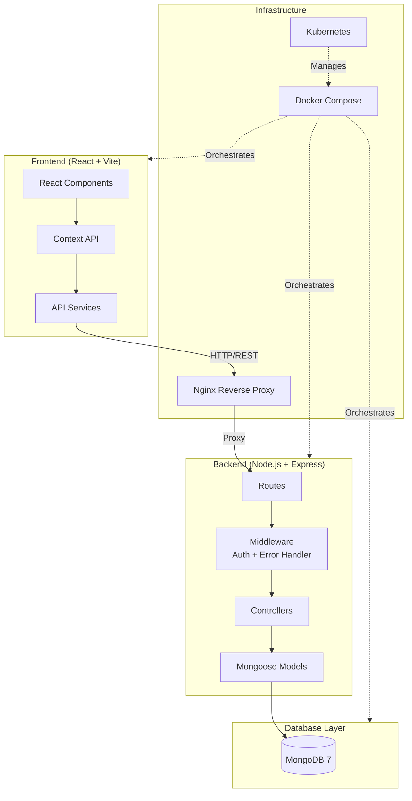

# 🏠 Property Rental and Tenant Management Platform


## 📖 Description

A full-stack **Property Rental and Tenant Management Platform** built with the MERN stack (MongoDB, Express.js, React, Node.js). This platform enables property owners, tenants, and managers to efficiently manage rental properties, leases, maintenance requests, and payments through a modern, role-based web application.

The system supports **four user roles** — Admin, Owner, Tenant, and Manager — each with tailored dashboards and workflows to streamline every aspect of property rental management.

---

## 📸 Screenshots

> _Screenshots will be added here after the UI is finalized._

| Dashboard | Properties | Maintenance |
|-----------|-----------|-------------|
|  |  |  |

---

## 🛠️ Technology Stack

| Layer | Technology | Version / Description |
|-------|-----------|------------------------|
| **Frontend** | React.js (Vite) | 18.x (SPA with modern hooks) |
| **Styling** | Tailwind CSS | 3.x (Navy & slate professional SaaS theme) |
| **Icons & Charts** | Lucide React + Recharts | Responsive SVGs & dynamic interactive graphs |
| **State & HTTP** | React Context API + Axios | Global JWT auth, request interceptors |
| **Backend** | Node.js + Express.js | 18.x / 4.x (REST API architecture) |
| **Database** | MongoDB + Mongoose ODM | 7.x (Strict schemas, indexing, relationships) |
| **Authentication** | JWT + bcryptjs | Role-based authorization (4 user roles) |
| **Containerization** | Docker + Docker Compose | Multi-stage Dockerfiles, internal network |
| **Orchestration** | Kubernetes (k8s) | Deployments, Services, PVC, ConfigMap, Secrets |
| **Web Server** | Nginx | Alpine production reverse proxy |
| **Testing** | Jest + Supertest + Vitest | Full backend API suite & frontend unit tests |

---

## ✨ Features

### Authentication & Authorization
- ✅ User registration with role selection (Owner, Tenant, Manager)
- ✅ Secure login with JWT authentication
- ✅ Role-based access control (RBAC) for all routes
- ✅ Password hashing with bcrypt
- ✅ Token-based session management

### Property Management
- ✅ Add, edit, and delete properties
- ✅ Property listing with search and filters
- ✅ Property details with image support
- ✅ Unit management within properties
- ✅ Availability tracking

### Tenant Management
- ✅ Tenant profiles and directory
- ✅ Lease agreement management
- ✅ Tenant-property assignment
- ✅ Move-in / Move-out workflows

### Lease Management
- ✅ Create and manage lease agreements
- ✅ Lease term tracking (start date, end date)
- ✅ Rent amount and payment schedule
- ✅ Lease renewal and termination

### Maintenance Requests
- ✅ Submit maintenance requests with descriptions
- ✅ Priority levels (Low, Medium, High, Emergency)
- ✅ Status tracking (Pending → In Progress → Completed)
- ✅ Assignment to maintenance staff
- ✅ Comment and update threads

### Payments
- ✅ Rent payment tracking
- ✅ Payment history and records
- ✅ Payment status management (Pending, Paid, Overdue)
- ✅ Monthly rent summaries

### Dashboards
- ✅ Admin dashboard with platform-wide analytics
- ✅ Owner dashboard with property portfolio overview
- ✅ Tenant dashboard with lease and payment info
- ✅ Manager dashboard with assigned properties

---

## 📁 Project Structure

```
PROJECT_DEVOPS/
├── backend/                    # Node.js + Express API server
│   ├── config/                 # Database and app configuration
│   │   └── db.js
│   ├── controllers/            # Route handler logic
│   │   ├── authController.js
│   │   ├── propertyController.js
│   │   ├── tenantController.js
│   │   ├── leaseController.js
│   │   ├── maintenanceController.js
│   │   └── paymentController.js
│   ├── middleware/              # Express middleware
│   │   ├── auth.js
│   │   └── errorHandler.js
│   ├── models/                 # Mongoose schemas
│   │   ├── User.js
│   │   ├── Property.js
│   │   ├── Tenant.js
│   │   ├── Lease.js
│   │   ├── Maintenance.js
│   │   └── Payment.js
│   ├── routes/                 # API route definitions
│   │   ├── auth.js
│   │   ├── properties.js
│   │   ├── tenants.js
│   │   ├── leases.js
│   │   ├── maintenance.js
│   │   └── payments.js
│   ├── seeds/                  # Database seed scripts
│   │   └── seed.js
│   ├── Dockerfile
│   ├── package.json
│   └── server.js
├── frontend/                   # React (Vite) frontend
│   ├── public/
│   ├── src/
│   │   ├── components/         # Reusable UI components
│   │   ├── pages/              # Page-level components
│   │   ├── context/            # React Context providers
│   │   ├── services/           # API service layer
│   │   ├── utils/              # Utility functions
│   │   ├── App.jsx
│   │   └── main.jsx
│   ├── Dockerfile
│   ├── nginx.conf
│   ├── package.json
│   └── vite.config.js
├── k8s/                        # Kubernetes manifests
│   ├── namespace.yaml
│   ├── configmap.yaml
│   ├── secret.example.yaml
│   ├── mongodb-pvc.yaml
│   ├── mongodb-deployment.yaml
│   ├── mongodb-service.yaml
│   ├── backend-deployment.yaml
│   ├── backend-service.yaml
│   ├── frontend-deployment.yaml
│   ├── frontend-service.yaml
│   └── ingress.yaml
├── docs/                       # Project documentation
│   ├── architecture.md
│   ├── api-documentation.md
│   ├── database-design.md
│   ├── deployment-guide.md
│   ├── user-guide.md
│   └── testing-guide.md
├── docker-compose.yml          # Docker Compose configuration
├── .env.example                # Environment variable template
├── .gitignore                  # Git ignore rules
├── PROJECT_STATUS.md           # Project status tracker
└── README.md                   # This file
```

---

## 📋 Prerequisites

Ensure you have the following installed:

| Tool | Version | Purpose |
|------|---------|---------|
| **Node.js** | 18.0+ | JavaScript runtime |
| **npm** | 9.0+ | Package manager |
| **MongoDB** | 7.0+ | Database (for local dev) |
| **Docker** | 24.0+ | Container runtime |
| **Docker Compose** | 2.20+ | Multi-container orchestration |
| **kubectl** | 1.28+ | Kubernetes CLI |
| **Minikube** | 1.31+ | Local Kubernetes cluster (optional) |

---

## 🚀 Installation & Setup

### Option 1: Local Development

1. **Clone the repository**
   ```bash
   git clone <repository-url>
   cd PROJECT_DEVOPS
   ```

2. **Set up environment variables**
   ```bash
   cp .env.example .env
   # Edit .env with your configuration
   ```

3. **Install backend dependencies**
   ```bash
   cd backend
   npm install
   ```

4. **Install frontend dependencies**
   ```bash
   cd ../frontend
   npm install
   ```

5. **Seed the database** (optional — loads demo data)
   ```bash
   cd ../backend
   npm run seed
   # or: node scripts/seed.js
   ```

6. **Start the backend**
   ```bash
   cd backend
   npm run dev
   # or: npm start
   ```

7. **Start the frontend** (in a new terminal)
   ```bash
   cd frontend
   npm run dev
   ```

8. **Access the application**
   - Frontend: `http://localhost:3000` (or Vite port displayed)
   - Backend API: `http://localhost:5000`

### Option 2: Docker Deployment

1. **Build and start all services**
   ```bash
   docker-compose up --build -d
   ```

2. **Seed the database** (first time only)
   ```bash
   docker exec -it rental-backend npm run seed
   ```

3. **Access the application**
   - Frontend: `http://localhost`
   - Backend API: `http://localhost:5000`

4. **View logs**
   ```bash
   docker-compose logs -f
   ```

5. **Stop services**
   ```bash
   docker-compose down
   ```

### Option 3: Kubernetes Deployment

See the [Deployment Guide](docs/deployment-guide.md) for complete Kubernetes instructions.

```bash
# Quick start with Minikube
minikube start
kubectl apply -f k8s/namespace.yaml
kubectl apply -f k8s/configmap.yaml
kubectl apply -f k8s/secret.example.yaml
kubectl apply -f k8s/mongodb-pvc.yaml
kubectl apply -f k8s/mongodb-deployment.yaml
kubectl apply -f k8s/mongodb-service.yaml
kubectl apply -f k8s/backend-deployment.yaml
kubectl apply -f k8s/backend-service.yaml
kubectl apply -f k8s/frontend-deployment.yaml
kubectl apply -f k8s/frontend-service.yaml
kubectl apply -f k8s/ingress.yaml
```

---

## 🔐 Demo Credentials

After running the seed script, use these verified accounts to log in (or use the one-click demo login buttons directly on the Login screen):

| Role | Email | Password | Access / Permissions |
|------|-------|----------|----------------------|
| **Admin** | `admin@propertymanager.com` | `admin123` | Global system control, user management, all properties, all reports |
| **Property Owner 1** | `owner1@test.com` | `owner123` | Owned properties, rental units, approve applications, income tracking |
| **Property Owner 2** | `owner2@test.com` | `owner123` | Owned properties portfolio, lease management, reports |
| **Property Manager 1** | `manager1@test.com` | `manager123` | Assigned properties, tenant relations, repair tickets dispatch |
| **Property Manager 2** | `manager2@test.com` | `manager123` | Assigned properties, operational management, inspection review |
| **Tenant 1** | `tenant1@test.com` | `tenant123` | Active resident portal, lease view, payment records, repair tickets |
| **Tenant 2** | `tenant2@test.com` | `tenant123` | Expiring lease alert resident portal, payment ledger |
| **Tenant 3** | `tenant3@test.com` | `tenant123` | Pending application tracking, browse units |

---

## 📡 API Documentation

Base URL: `http://localhost:5000/api`

| Method | Endpoint | Description | Auth Required |
|--------|----------|-------------|---------------|
| POST | `/api/auth/register` | Register a new user | No |
| POST | `/api/auth/login` | Login and get JWT token | No |
| GET | `/api/auth/me` | Get current user profile | Yes |
| GET | `/api/properties` | List all properties | Yes |
| POST | `/api/properties` | Create a new property | Yes (Owner/Admin) |
| GET | `/api/properties/:id` | Get property details | Yes |
| PUT | `/api/properties/:id` | Update a property | Yes (Owner/Admin) |
| DELETE | `/api/properties/:id` | Delete a property | Yes (Owner/Admin) |
| GET | `/api/tenants` | List all tenants | Yes |
| POST | `/api/tenants` | Add a new tenant | Yes (Owner/Admin) |
| GET | `/api/leases` | List all leases | Yes |
| POST | `/api/leases` | Create a new lease | Yes (Owner/Admin) |
| GET | `/api/maintenance` | List maintenance requests | Yes |
| POST | `/api/maintenance` | Create a maintenance request | Yes |
| PUT | `/api/maintenance/:id` | Update request status | Yes |
| GET | `/api/payments` | List payments | Yes |
| POST | `/api/payments` | Record a payment | Yes |

For complete API documentation, see [API Documentation](docs/api-documentation.md).

---

## ⚙️ Environment Variables

| Variable | Description | Default |
|----------|-------------|---------|
| `PORT` | Backend server port | `5000` |
| `MONGODB_URI` | MongoDB connection string | `mongodb://localhost:27017/property_rental` |
| `JWT_SECRET` | Secret key for JWT signing | — |
| `JWT_EXPIRE` | JWT token expiration time | `7d` |
| `NODE_ENV` | Environment (development/production) | `development` |
| `MONGO_INITDB_ROOT_USERNAME` | MongoDB root username | `admin` |
| `MONGO_INITDB_ROOT_PASSWORD` | MongoDB root password | — |
| `VITE_API_URL` | Frontend API base URL | `http://localhost:5000` |

---

## 🐳 Docker Commands

```bash
# Build and start
docker-compose up --build -d

# View running containers
docker-compose ps

# View logs
docker-compose logs -f
docker-compose logs -f backend    # specific service

# Stop services
docker-compose down

# Stop and remove volumes
docker-compose down -v

# Rebuild a specific service
docker-compose build backend
docker-compose up -d backend

# Access container shell
docker exec -it rental-backend sh
docker exec -it rental-mongodb mongosh
```

---

## ☸️ Kubernetes Deployment Guide

### Deploy to Minikube

```bash
# Start Minikube
minikube start --driver=docker

# Enable ingress addon
minikube addons enable ingress

# Build images inside Minikube
eval $(minikube docker-env)
docker build -t property-rental-backend:latest ./backend
docker build -t property-rental-frontend:latest ./frontend

# Apply all manifests
kubectl apply -f k8s/

# Check deployment status
kubectl get all -n rental-platform

# Access the application
minikube service frontend-service -n rental-platform
```

### Useful kubectl Commands

```bash
# View pods
kubectl get pods -n rental-platform

# View logs
kubectl logs -f deployment/backend -n rental-platform

# Describe a resource
kubectl describe pod <pod-name> -n rental-platform

# Port forward for debugging
kubectl port-forward svc/backend-service 5000:5000 -n rental-platform

# Scale deployments
kubectl scale deployment backend --replicas=3 -n rental-platform
```

---

## 🧪 Testing

```bash
# Run backend tests
cd backend
npm test

# Run frontend tests
cd frontend
npm test

# Run with coverage
npm test -- --coverage
```

For detailed testing documentation, see [Testing Guide](docs/testing-guide.md).

---

## 🏗️ Project Architecture



---

## 🤝 Contributing

We welcome contributions! Please follow these steps:

1. **Fork** the repository
2. **Create** a feature branch (`git checkout -b feature/amazing-feature`)
3. **Commit** your changes (`git commit -m 'Add amazing feature'`)
4. **Push** to the branch (`git push origin feature/amazing-feature`)
5. **Open** a Pull Request

### Code Style
- Follow ESLint configurations for both frontend and backend
- Write meaningful commit messages
- Add tests for new features
- Update documentation as needed

---

## 📄 License

This project is licensed under the **MIT License**. See the [LICENSE](LICENSE) file for details.

---

## 📞 Support

For questions, issues, or feature requests:
- Open an [Issue](../../issues) on GitHub
- Check the [Documentation](docs/) for guides

---

<p align="center">
  Built with ❤️ using the MERN Stack
</p>
