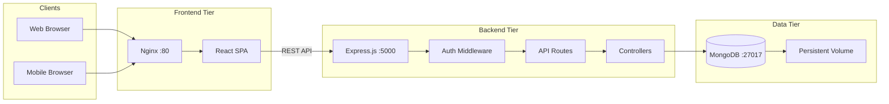
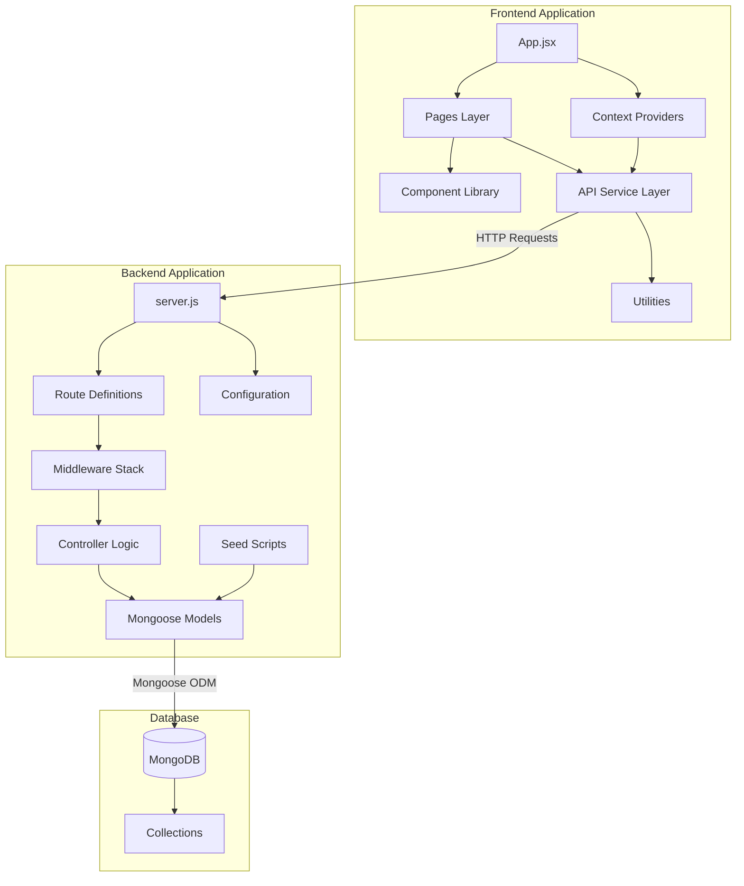
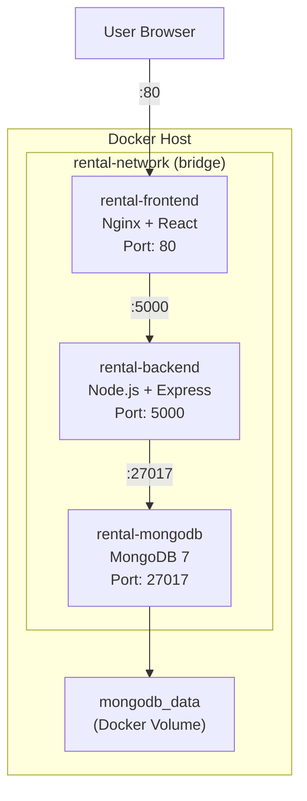
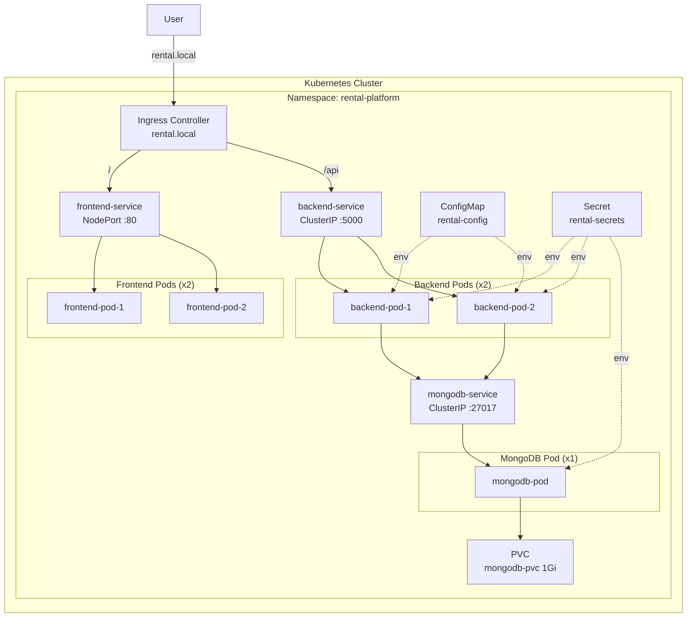
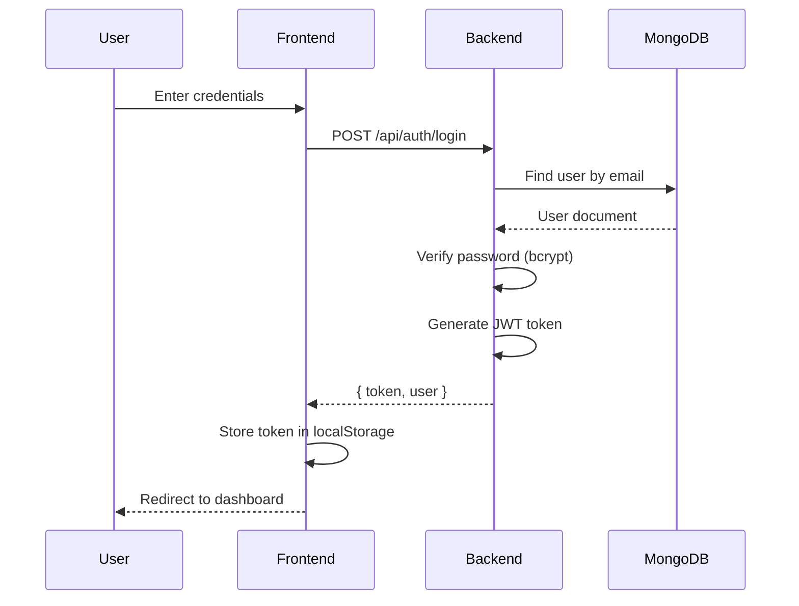
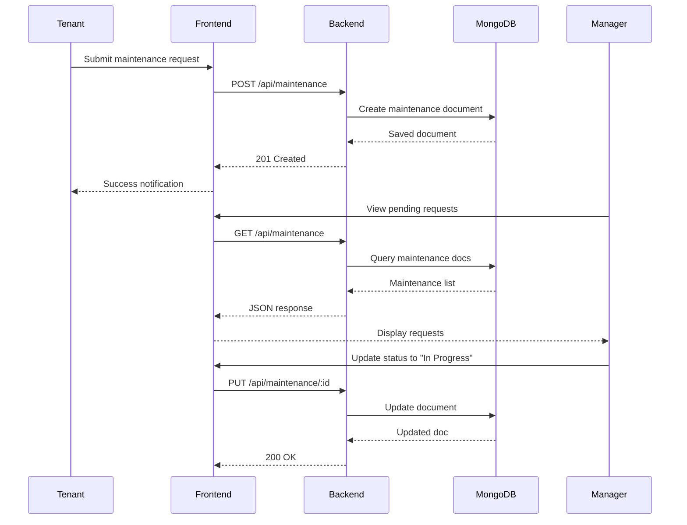
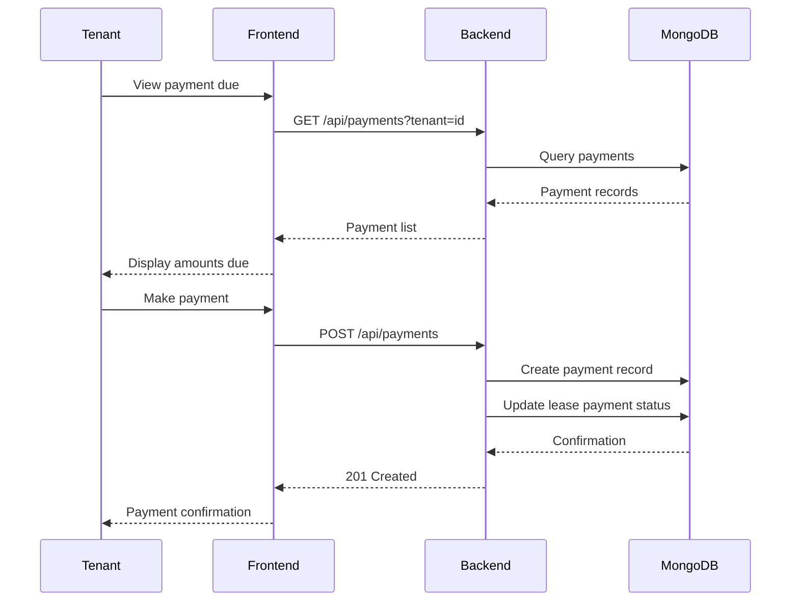

# System Architecture

## Overview

The Property Rental and Tenant Management Platform follows a modern three-tier architecture with containerized deployment support. This document describes the system's architecture, components, and their interactions.

---

## High-Level Architecture

---

## Component Diagram

---

## Deployment Diagram

### Docker Compose Deployment

### Kubernetes Deployment

---

## Data Flow Diagrams

### Authentication Flow

### Maintenance Request Flow

### Payment Flow

---

## Technology Stack Details

### Frontend Stack

| Technology | Purpose | Details |
|-----------|---------|---------|
| **React 18** | UI Library | Component-based architecture with hooks |
| **Vite** | Build Tool | Fast HMR, optimized production builds |
| **Material UI 5** | Component Library | Pre-built accessible UI components |
| **React Router v6** | Routing | Client-side routing with protected routes |
| **Axios** | HTTP Client | Promise-based API communication |
| **Context API** | State Management | Global state for auth and app data |

### Backend Stack

| Technology | Purpose | Details |
|-----------|---------|---------|
| **Node.js 18** | Runtime | JavaScript server-side execution |
| **Express.js 4** | Framework | Minimalist web framework for APIs |
| **Mongoose 7** | ODM | MongoDB object modeling and validation |
| **JWT** | Authentication | Stateless token-based auth |
| **bcryptjs** | Security | Password hashing |
| **cors** | Security | Cross-origin resource sharing |
| **dotenv** | Configuration | Environment variable management |

### Infrastructure Stack

| Technology | Purpose | Details |
|-----------|---------|---------|
| **Docker** | Containerization | Application packaging |
| **Docker Compose** | Orchestration | Multi-container local deployment |
| **Kubernetes** | Orchestration | Production container management |
| **Nginx** | Web Server | Static file serving & reverse proxy |
| **MongoDB 7** | Database | NoSQL document database |

---

## Security Architecture

### Authentication & Authorization

- **JWT Tokens**: Stateless authentication with configurable expiration
- **Password Hashing**: bcrypt with salt rounds for secure storage
- **Role-Based Access Control**: Four roles with distinct permissions
- **Protected Routes**: Middleware-based route protection on both frontend and backend

### Role Permissions Matrix

| Resource | Admin | Owner | Manager | Tenant |
|----------|-------|-------|---------|--------|
| View all users | ✅ | ❌ | ❌ | ❌ |
| Manage properties | ✅ | ✅ (own) | ✅ (assigned) | ❌ |
| Manage tenants | ✅ | ✅ (own) | ✅ (assigned) | ❌ |
| Manage leases | ✅ | ✅ (own) | ✅ (assigned) | 👁️ (own) |
| Maintenance requests | ✅ | ✅ | ✅ | ✅ (own) |
| Payments | ✅ | ✅ | ✅ | ✅ (own) |
| View dashboard | ✅ | ✅ | ✅ | ✅ |

---

## Scalability Considerations

- **Horizontal Scaling**: Backend pods can be scaled independently via Kubernetes replicas
- **Database**: MongoDB supports replica sets for high availability (not included in this MVP)
- **Stateless Backend**: JWT-based auth enables easy horizontal scaling
- **CDN-Ready Frontend**: Static assets served via Nginx can be cached at CDN layer
- **Persistent Storage**: MongoDB data persisted via Docker volumes or Kubernetes PVCs
