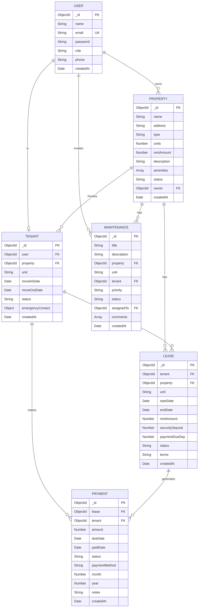

# Database Design

## Overview

The Property Rental and Tenant Management Platform uses **MongoDB 7** as its primary database, with **Mongoose 7** as the Object Document Mapper (ODM). The database is designed around six core collections that model the relationships between users, properties, tenants, leases, maintenance requests, and payments.

---

## Entity-Relationship Diagram



---

## Collection Schemas

### Users Collection

Stores all user accounts including admins, owners, tenants, and managers.

```javascript
{
  _id: ObjectId,
  name: {
    type: String,
    required: true,
    trim: true,
    minlength: 2,
    maxlength: 50
  },
  email: {
    type: String,
    required: true,
    unique: true,
    lowercase: true,
    match: /^\w+([.-]?\w+)*@\w+([.-]?\w+)*(\.\w{2,3})+$/
  },
  password: {
    type: String,
    required: true,
    minlength: 6,
    select: false  // Not returned in queries by default
  },
  role: {
    type: String,
    enum: ['admin', 'owner', 'tenant', 'manager'],
    default: 'tenant'
  },
  phone: {
    type: String,
    match: /^[0-9]{10,15}$/
  },
  createdAt: {
    type: Date,
    default: Date.now
  }
}
```

**Indexes**:
| Index | Fields | Type | Purpose |
|-------|--------|------|---------|
| Email unique | `email` | Unique | Prevent duplicate accounts |
| Role index | `role` | Regular | Filter users by role |

---

### Properties Collection

Stores property listings owned by property owners.

```javascript
{
  _id: ObjectId,
  name: {
    type: String,
    required: true,
    trim: true
  },
  address: {
    type: String,
    required: true
  },
  type: {
    type: String,
    required: true,
    enum: ['apartment', 'house', 'condo', 'commercial']
  },
  units: {
    type: Number,
    required: true,
    min: 1
  },
  rentAmount: {
    type: Number,
    required: true,
    min: 0
  },
  description: {
    type: String,
    maxlength: 1000
  },
  amenities: [{
    type: String
  }],
  status: {
    type: String,
    enum: ['available', 'occupied', 'maintenance'],
    default: 'available'
  },
  owner: {
    type: ObjectId,
    ref: 'User',
    required: true
  },
  createdAt: {
    type: Date,
    default: Date.now
  }
}
```

**Indexes**:
| Index | Fields | Type | Purpose |
|-------|--------|------|---------|
| Owner index | `owner` | Regular | Find properties by owner |
| Status index | `status` | Regular | Filter by availability |
| Name text | `name`, `address` | Text | Full-text search |

---

### Tenants Collection

Stores tenant information and their association with properties.

```javascript
{
  _id: ObjectId,
  user: {
    type: ObjectId,
    ref: 'User',
    required: true
  },
  property: {
    type: ObjectId,
    ref: 'Property',
    required: true
  },
  unit: {
    type: String,
    required: true
  },
  moveInDate: {
    type: Date,
    required: true
  },
  moveOutDate: {
    type: Date
  },
  status: {
    type: String,
    enum: ['active', 'inactive', 'pending'],
    default: 'active'
  },
  emergencyContact: {
    name: String,
    phone: String,
    relationship: String
  },
  createdAt: {
    type: Date,
    default: Date.now
  }
}
```

**Indexes**:
| Index | Fields | Type | Purpose |
|-------|--------|------|---------|
| User index | `user` | Regular | Find tenant by user |
| Property index | `property` | Regular | Find tenants by property |
| Compound | `property`, `unit` | Compound | Locate tenant in specific unit |

---

### Leases Collection

Stores lease agreements between tenants and property owners.

```javascript
{
  _id: ObjectId,
  tenant: {
    type: ObjectId,
    ref: 'Tenant',
    required: true
  },
  property: {
    type: ObjectId,
    ref: 'Property',
    required: true
  },
  unit: {
    type: String,
    required: true
  },
  startDate: {
    type: Date,
    required: true
  },
  endDate: {
    type: Date,
    required: true
  },
  rentAmount: {
    type: Number,
    required: true,
    min: 0
  },
  securityDeposit: {
    type: Number,
    required: true,
    min: 0
  },
  paymentDueDay: {
    type: Number,
    default: 1,
    min: 1,
    max: 28
  },
  status: {
    type: String,
    enum: ['active', 'expired', 'terminated', 'pending'],
    default: 'pending'
  },
  terms: {
    type: String,
    maxlength: 5000
  },
  createdAt: {
    type: Date,
    default: Date.now
  }
}
```

**Indexes**:
| Index | Fields | Type | Purpose |
|-------|--------|------|---------|
| Tenant index | `tenant` | Regular | Find leases by tenant |
| Property index | `property` | Regular | Find leases by property |
| Status index | `status` | Regular | Filter active/expired leases |
| Date range | `startDate`, `endDate` | Compound | Date-based queries |

---

### Maintenance Collection

Stores maintenance and repair requests from tenants.

```javascript
{
  _id: ObjectId,
  title: {
    type: String,
    required: true,
    trim: true,
    maxlength: 200
  },
  description: {
    type: String,
    required: true,
    maxlength: 2000
  },
  property: {
    type: ObjectId,
    ref: 'Property',
    required: true
  },
  unit: {
    type: String,
    required: true
  },
  tenant: {
    type: ObjectId,
    ref: 'User',
    required: true
  },
  priority: {
    type: String,
    enum: ['low', 'medium', 'high', 'emergency'],
    default: 'medium'
  },
  status: {
    type: String,
    enum: ['pending', 'in-progress', 'completed', 'cancelled'],
    default: 'pending'
  },
  assignedTo: {
    type: ObjectId,
    ref: 'User'
  },
  comments: [{
    user: { type: ObjectId, ref: 'User' },
    text: String,
    createdAt: { type: Date, default: Date.now }
  }],
  createdAt: {
    type: Date,
    default: Date.now
  }
}
```

**Indexes**:
| Index | Fields | Type | Purpose |
|-------|--------|------|---------|
| Property index | `property` | Regular | Find requests by property |
| Tenant index | `tenant` | Regular | Find requests by tenant |
| Status-Priority | `status`, `priority` | Compound | Filter and sort requests |

---

### Payments Collection

Stores rent payment records linked to leases and tenants.

```javascript
{
  _id: ObjectId,
  lease: {
    type: ObjectId,
    ref: 'Lease',
    required: true
  },
  tenant: {
    type: ObjectId,
    ref: 'User',
    required: true
  },
  amount: {
    type: Number,
    required: true,
    min: 0
  },
  dueDate: {
    type: Date,
    required: true
  },
  paidDate: {
    type: Date
  },
  status: {
    type: String,
    enum: ['pending', 'paid', 'overdue', 'partial'],
    default: 'pending'
  },
  paymentMethod: {
    type: String,
    enum: ['cash', 'bank_transfer', 'check', 'online']
  },
  month: {
    type: Number,
    required: true,
    min: 1,
    max: 12
  },
  year: {
    type: Number,
    required: true
  },
  notes: {
    type: String,
    maxlength: 500
  },
  createdAt: {
    type: Date,
    default: Date.now
  }
}
```

**Indexes**:
| Index | Fields | Type | Purpose |
|-------|--------|------|---------|
| Lease index | `lease` | Regular | Find payments by lease |
| Tenant index | `tenant` | Regular | Find payments by tenant |
| Period | `month`, `year` | Compound | Monthly payment queries |
| Status index | `status` | Regular | Filter by payment status |
| Unique period | `lease`, `month`, `year` | Unique | Prevent duplicate payments |

---

## Relationships

| Relationship | Type | Description |
|-------------|------|-------------|
| User → Property | One-to-Many | An owner can have multiple properties |
| User → Tenant | One-to-One | A user can be one tenant |
| Property → Tenant | One-to-Many | A property can house multiple tenants |
| Property → Lease | One-to-Many | A property can have multiple leases |
| Tenant → Lease | One-to-Many | A tenant can have multiple leases (sequential) |
| Lease → Payment | One-to-Many | A lease generates monthly payments |
| Property → Maintenance | One-to-Many | A property can have multiple requests |
| User → Maintenance | One-to-Many | A user can create multiple requests |

---

## Sample Documents

### Sample User
```json
{
  "_id": "65a1b2c3d4e5f6g7h8i9j0k1",
  "name": "Admin User",
  "email": "admin@rental.com",
  "password": "$2a$10$hashed_password_here",
  "role": "admin",
  "phone": "5551234567",
  "createdAt": "2024-01-01T00:00:00.000Z"
}
```

### Sample Property
```json
{
  "_id": "65b2c3d4e5f6g7h8i9j0k1l2",
  "name": "Sunset Apartments",
  "address": "123 Main St, Springfield, IL 62701",
  "type": "apartment",
  "units": 12,
  "rentAmount": 1500,
  "description": "Modern apartment complex with full amenities",
  "amenities": ["parking", "laundry", "gym", "pool"],
  "status": "available",
  "owner": "65a1b2c3d4e5f6g7h8i9j0k2",
  "createdAt": "2024-01-05T10:00:00.000Z"
}
```

### Sample Lease
```json
{
  "_id": "65c3d4e5f6g7h8i9j0k1l2m3",
  "tenant": "65d4e5f6g7h8i9j0k1l2m3n4",
  "property": "65b2c3d4e5f6g7h8i9j0k1l2",
  "unit": "3A",
  "startDate": "2024-01-01T00:00:00.000Z",
  "endDate": "2024-12-31T23:59:59.000Z",
  "rentAmount": 1500,
  "securityDeposit": 3000,
  "paymentDueDay": 1,
  "status": "active",
  "terms": "Standard 12-month residential lease",
  "createdAt": "2023-12-15T14:00:00.000Z"
}
```

### Sample Maintenance Request
```json
{
  "_id": "65e5f6g7h8i9j0k1l2m3n4o5",
  "title": "Leaking faucet in kitchen",
  "description": "The kitchen faucet has been dripping constantly for 2 days. Water is pooling under the sink.",
  "property": "65b2c3d4e5f6g7h8i9j0k1l2",
  "unit": "3A",
  "tenant": "65a1b2c3d4e5f6g7h8i9j0k3",
  "priority": "medium",
  "status": "in-progress",
  "assignedTo": "65a1b2c3d4e5f6g7h8i9j0k4",
  "comments": [
    {
      "user": "65a1b2c3d4e5f6g7h8i9j0k4",
      "text": "Plumber scheduled for tomorrow 2-4 PM",
      "createdAt": "2024-01-16T09:00:00.000Z"
    }
  ],
  "createdAt": "2024-01-15T10:30:00.000Z"
}
```

### Sample Payment
```json
{
  "_id": "65f6g7h8i9j0k1l2m3n4o5p6",
  "lease": "65c3d4e5f6g7h8i9j0k1l2m3",
  "tenant": "65a1b2c3d4e5f6g7h8i9j0k3",
  "amount": 1500,
  "dueDate": "2024-02-01T00:00:00.000Z",
  "paidDate": "2024-01-28T16:30:00.000Z",
  "status": "paid",
  "paymentMethod": "bank_transfer",
  "month": 2,
  "year": 2024,
  "notes": "February rent - paid early",
  "createdAt": "2024-01-28T16:30:00.000Z"
}
```
